<!--
README style — keep it scannable, not a wall of text:
- One idea per paragraph; paragraphs ≤ 3 lines. Split anything longer.
- Every section starts with a heading (##); sub-topics get ###. No section longer than one screen.
- Lists over prose for anything with 3+ items; bullets ≤ 2 lines.
- Tables for comparisons (commands, venues, checks). Code blocks for every command and file.
- A blank line between every block. Bold only for the one phrase a skimmer must see.
- Mechanics and edge cases live in docs/, linked — not inline.
- A reader must be able to answer "what is it, which venues, how do I start" from the first screen.
- Sparse emoji are fine where they help rhythm and scanning (e.g. one per section heading or feature bullet); never decorative, never several in a row.
- One name per thing, everywhere (lint, build, venue preset, kind, skill, papersDir), each explained once, before it is used.
- Editing this file: re-read all of it first, and change it so it still reads as one document — the opening, the diagram, the order and the names your change touches. Remove or merge what it makes redundant. Never bolt on a section or patch one paragraph in isolation.
-->

# paperlint

[](https://www.npmjs.com/package/paperlint)


**Write a research paper in LaTeX from idea to camera-ready, and catch what gets it sent back
before you submit.** It comes in two parts:

- ✅ **A linter** — a command-line tool, no AI needed. Its headline catches:
  - 📏 a paper over the page limit for its kind at your venue;
  - 🔤 the wrong font — LaTeX silently fell back to Computer Modern because a package was missing;
  - 🔗 a bad reference — a cited work that does not exist, or lists the preprint's authors.

  Smaller slips too: `§` for "Section", `.05` for `0.05` — fixed for you.

- 🧠 **Skills for [Claude Code](https://claude.com/claude-code)** — optional, covering the
  whole pipeline: the idea, the venue, the study, the draft, the reviews, submission.

> ⚠️ **An aid, not a guarantee.** A clean run does not mean your paper meets the venue's rules:
> presets are transcribed from calls for papers that change, and any check can miss something.
> Check against the venue's own call and template. Provided "as is", without warranty — see
> [LICENSE](LICENSE).

## Contents

- [The pipeline](#-the-pipeline)
  - [The flow](#the-flow)
  - [Where things live](#where-things-live)
- [Supported venues](#-supported-venues)
- [Getting started](#-getting-started)
  - [A new paper](#a-new-paper)
  - [A paper you already have](#a-paper-you-already-have)
- [Commands](#-commands)
- [Skills](#-skills)
- [Lint and build](#-lint-and-build)
- [Configuration](#-configuration)
  - [Add a venue that isn't listed](#-add-a-venue-that-isnt-listed)
- [Run it in CI](#-run-it-in-ci)
- [FAQ](#-faq)
- [Docs](#-docs)

## 🧭 The pipeline

```text
stage           what you get                          where it goes
1 idea          a go / no-go, with the reason         siblings/
2 venue         venues ranked, deadlines planned      paperlint.json, the venue's corpus
3 study         a study design, honest statistics     repro/<study>/
4 draft         a first draft, then a tighter one     paper.tex, sections/, figures/
5 review        the objections, before the reviewers  reviews/, PIPELINE-STATUS.md
6 submit        a PDF within the limit, recorded      paper.pdf, versions/, submission/
7 camera-ready  the final, de-anonymised PDF          versions/, talk/
8 extend        a plan for the next paper             a new paper folder

skills: every stage; optional, with Claude Code
lint:   any stage once the paper folder exists (paperlint new) — when you run it, and in CI
build:  stages 6–7; compiles and measures the PDF, and lint then checks pages, fonts, references
hook:   with Claude Code, refuses a new file in the wrong place before it is written
```

### The flow

Each box names the stage's skills, what it writes, and what checks it. Stage 3 is drawn from the
inside: a study's pre-registration and its human labels are made there.

```mermaid
flowchart TB
  N["<b>paperlint new</b><br/>creates the paper folder<br/>checked from here on:<br/>every lint · paper/allowed-files-only<br/>every new file · hook paper-folder-layout"]
  S1["<b>1 · idea</b><br/>research-ideate · map-prior-work<br/>analyze-sibling-paper<br/>writes: siblings/<br/>checked by: sibling/frontmatter"]
  S2["<b>2 · venue</b><br/>find-venue · plan-paper-timeline<br/>study-accepted-papers, mode A or B<br/>writes: paperlint.json, a report in reviews/<br/>checked by: review/frontmatter"]
  V[("<b>#lt;papers-root#gt;/venues/#lt;venue#gt;/</b><br/>beside the papers, not in one:<br/>the venue's accepted papers,<br/>shared by every paper aimed at it<br/>checked by: nothing")]
  subgraph S3["3 · study: repro/#lt;slug#gt;-YYYY-MM-DD/"]
    direction TB
    D["<b>design</b> · build-benchmark<br/>writes: the study's README.md<br/>checked by: repro/allowed-files-only"]
    P["<b>pre-register</b> · build-benchmark<br/>writes: prereg.json, before the draw<br/>checked by: study/declare-sample (experimental, off)"]
    A["<b>author check</b> · you see the drawn units<br/>writes: author_check in prereg.json<br/>checked by: study/declare-sample (experimental, off)"]
    R["<b>run</b> · your scripts<br/>writes: the study folder,<br/>repro/tools/, repro/data/<br/>checked by: repro/allowed-files-only"]
    L["<b>labels</b> · build-label-page<br/>a phone page; the answers go<br/>into the study's data/"]
    Y["<b>analysis</b> · build-benchmark<br/>writes: the numbers, NOTES.md"]
    D --> P --> A --> R --> L --> Y
  end
  S4["<b>4 · draft</b><br/>draft-paper · argument-arc · tighten-paper<br/>writes: paper.tex, sections/, figures/<br/>checked by: the tex/* rules<br/>hook paper-edit-guard: no shell writes"]
  S5["<b>5 · review</b><br/>grade-paper-writing · verify-citations<br/>pc-panel-review · harden-paper<br/>study-accepted-papers, mode C or D<br/>writes: reviews/, the scorecard<br/>in PIPELINE-STATUS.md<br/>checked by: review/frontmatter"]
  S6["<b>6 · submit</b><br/>paperlint build · submit-paper<br/>writes: paper.pdf, _build/,<br/>versions/, submission/<br/>checked by: format/page-limit, pdf/*,<br/>anonymity/identity, paper/stages"]
  S7["<b>7 · camera-ready</b><br/>camera-ready<br/>writes: versions/, talk/<br/>checked by: paper/stages, talk/*"]
  S8["<b>8 · extend</b><br/>extend-paper<br/>writes: a new paper folder"]
  N --> S1 --> S2 --> D
  Y --> S4 --> S5 --> S6 --> S7 --> S8
  S2 -. fills .-> V
  V -. read again .-> S5
```



The cylinder is a venue's corpus of accepted papers: it lives beside the papers, not inside one
([`docs/venues.md`](docs/venues.md)). Every check and hook, and the moment it runs:
[`docs/layout.md`](docs/layout.md#what-runs-when).

### Where things live

`paperlint new` creates a paper folder in the papers directory (`papersDir`, default `papers/`), with the
folders every paper uses (an empty one holds a `.gitkeep`). Everything a stage writes has one place:

<!-- layout:begin — drawn from src/domain/paper-layout.ts (PAPERS_LAYOUT_TREE); src/layout-docs.test.ts fails when this block differs -->

```text
<papers-root>/
├── venues/                            ← outside every paper folder: one folder per venue
│   └── <venue>/                       ← that venue's accepted papers, shared by every paper aimed at it
└── <paper>/                           ← one folder per paper, named after the work; its root holds only what is below
    ├── PIPELINE-STATUS.md             ← the paper's one live-state file: stages, plan, scorecard
    ├── paper.tex                      ← the source; `paperlint build` compiles it
    ├── paperlint.json                 ← the paper's settings
    ├── README.md                      ← what the paper is
    ├── CLAUDE.md                      ← the paper's agent rules
    ├── CLAIMS.md                      ← the claims ledger
    ├── NOTES.md                       ← each number in the paper → the data it comes from
    ├── SUBMIT-CHECKLIST.md            ← the venue's format and submission mechanics
    ├── .gitignore                     ← keeps the build's byproducts out of git
    ├── paper.pdf                      ← the built PDF
    ├── *.tex *.bib *.cls *.sty *.bst  ← what TeX and bibtex look up beside paper.tex
    ├── _build/                        ← the facts `paperlint build` writes
    ├── versions/                      ← each stage's frozen PDF and source
    ├── reviews/                       ← dated reviews and pass reports
    ├── siblings/                      ← the cards of competing papers
    ├── research/                      ← dated research and decision records
    ├── repro/                         ← the reproduction artifact
    │   ├── README.md                  ← the index: one line per study
    │   ├── .gitignore                 ← keeps the scripts' byproducts out of git
    │   ├── tools/                     ← scripts used across the paper (numbers, figures, anonymity check, harnesses)
    │   ├── data/                      ← shared data (tables, caches)
    │   └── <slug>-YYYY-MM-DD/         ← one folder per study or spike (<slug>-YYYY-MM for one that ran over weeks)
    │       └── README.md              ← required: what it asks, how to run it, what it found
    ├── figures/                       ← graphics and their sources
    ├── sections/                      ← the body, when it is split
    ├── talk/                          ← the talk's files
    ├── submission/                    ← forms, portal records, mail with the venue, the anonymized upload
    └── extra/                         ← anything; never judged
```

<!-- layout:end -->

| place                             | details                                                                                                                       |
| --------------------------------- | ----------------------------------------------------------------------------------------------------------------------------- |
| `venues/<venue>/`                 | [what a venue's corpus holds, when it is made, who reads it](docs/venues.md)                                                  |
| the paper folder's root           | [what may stand there, and where anything else goes](docs/rules/paper/allowed-files-only.md)                                  |
| `PIPELINE-STATUS.md`, `versions/` | [the stages, and the frozen PDF of each](docs/rules.md#the-scorecards-bytes-and-sourcebytes)                                  |
| `reviews/`, `siblings/`           | [the record each file keeps in its frontmatter](docs/configuration.md#records-in-frontmatter-checked-by-shipped-json-schemas) |
| `repro/` and its study folders    | [the index, `tools/`, `data/`, one dated folder per study](docs/rules/repro/allowed-files-only.md)                            |
| `repro/<study>/prereg.json`       | [what a study's pre-registration must declare (experimental, off by default)](docs/rules/study/declare-sample.md)             |
| `paper.pdf`, `_build/`            | [how `paperlint build` compiles and measures](docs/configuration.md#how-paperlint-build-compiles-a-paper)                     |
| `submission/`                     | [the submission on the venue's portal](docs/submission.md)                                                                    |
| `talk/`                           | [the talk's files and what is checked](docs/talk.md)                                                                          |
| every place                       | [which stage writes it, which skill, which check](docs/layout.md)                                                             |

## 🎯 Supported venues

A **venue preset** holds a venue's format and page limits. A paper's **kind** picks which limit
applies: at AgenticDev a `short` paper gets 5 pages and a `full` one 10. You choose it once per paper.

| preset                      | venue               | format                        | kinds and page limits                                                                                                                                    |
| --------------------------- | ------------------- | ----------------------------- | -------------------------------------------------------------------------------------------------------------------------------------------------------- |
| `paperlint:acm-sigconf`     | any ACM conference  | ACM two-column                | no kinds: the format only, no page limit                                                                                                                 |
| `paperlint:agenticdev`      | AgenticDev @ ASE    | ACM two-column                | `short` 5, `full` 10, `demo` 5 pages, + 2 pages of references                                                                                            |
| `paperlint:aisec`           | AISec @ ACM CCS     | ACM two-column                | `research`, `benchmark`, `position`, `sok`: 10 pages + 2 pages of references                                                                             |
| `paperlint:realm`           | REALM @ EMNLP       | ACL two-column, A4            | `long` 8, `short` 4 — recorded, not checked ([why](docs/rules.md#checks-against-the-venue))                                                              |
| `paperlint:ieee-conference` | any IEEE conference | IEEE two-column               | no kinds: the format only, no page limit                                                                                                                 |
| `paperlint:aidc`            | AIDC @ IEEE ACSAC   | IEEE two-column, `compsoc`    | `regular` 12, `short` 6, counted before the references ([why](docs/rules.md#checks-against-the-venue)); requires the «LLM Usage Statement»; double-blind |
| `paperlint:msr`             | MSR (Technical)     | IEEE two-column, no `compsoc` | `technical` 10 pages, appendices included, + 2 pages of only references ([why](docs/rules.md#checks-against-the-venue)); double-blind                    |

Not shipped yet: USENIX, NeurIPS, Springer, IEEE venues other than AIDC and MSR, and ACL venues other than
REALM.
[Add yours](#-add-a-venue-that-isnt-listed) in one small file.

## 🚀 Getting started

### A new paper

<!-- `vigiles:symbol src/init.ts#init` — `npm run check` fails if this function is renamed or removed. -->

1. Install (Node 22.13 or newer):

   ```sh
   npm i -D paperlint
   ```

2. Set up. `init` asks three questions: where your papers live (default `papers/`), whether to
   install TeX Live now, and whether to add a CI workflow. With Claude Code it also installs the
   skills and four hooks ([what they do](docs/install.md)).

   ```sh
   npx paperlint init
   ```

3. Create a paper. `--venue` names its venue preset from the table above, `--kind` which of its page
   limits applies. Name the folder after the work, not the venue: a rejected paper moves to another
   venue and keeps its folder, so `new` refuses a name like `aisec-2026` (`--allow-venue-name` when
   the word really is the work's):

   <!-- `vigiles:symbol src/new-paper.ts#newPaper` — `npm run check` fails if this function is renamed or removed. -->
   <!-- `vigiles:symbol src/new-paper.ts#ALLOW_VENUE_NAME` — the flag's one spelling; `npm run check` fails if it is renamed or removed. -->

   ```sh
   npx paperlint new my-paper --venue agenticdev --kind short
   ```

   It writes `papers/my-paper/` (in the folder you gave `init`) with three files:
   - `paper.tex` — your paper;
   - `paperlint.json` — its venue preset and kind;
   - `PIPELINE-STATUS.md` — which stage the paper is at; the skills read and update it;

   and the folders every paper uses, so the layout that `paper/allowed-files-only` and `repro/allowed-files-only`
   enforce is visible from the first commit: `reviews/`, `research/`, `figures/`, `versions/`,
   `submission/`, and `repro/` with an index (`README.md`: one line per study), `tools/` and `data/`.
   An empty folder holds a `.gitkeep` so git keeps it; delete the `.gitkeep` once the folder has a
   real file. Not made, because they depend on the work: `siblings/` (the first competing paper's
   card), `sections/` (a split body), `talk/` (a declared talk) and `extra/` (the never-judged spillover).

4. Build the PDF. **This needs TeX Live, a ~270 MB download (~3 min, once).** If you said no in
   `init`, run `npx paperlint toolchain` first.

   ```sh
   npx paperlint build papers/my-paper
   ```

5. Check it:

   ```sh
   npx paperlint lint
   ```

   On the stub from step 3 the first run already catches something (output shortened):

   ```text
   papers/my-paper/paper.tex
     1:1   error    1 column(s), AgenticDev requires 2 — the wrong document class or class option   pdf/geometry
     1:1   error    no font starts with `LinLibertine` (body text of AgenticDev); the PDF has: CMR10, …   pdf/fonts
     8:4   warning  `§` instead of the word «Section» — `paperlint lint --fix` writes it              paper/section-word
   ```

   `new` writes a format-neutral stub in plain `article`, and AgenticDev wants ACM's class. Make
   the first line `\documentclass[sigconf]{acmart}`, build again, and the errors are gone.

### A paper you already have

paperlint finds a paper by its folder: `<papersDir>/<name>/`, with the main file named `paper.tex`.

1. Put the paper there — for example `papers/my-paper/paper.tex`, the rest of its files beside it. If
   your paper folders already live elsewhere, say `thesis/`, [set `papersDir`](#-configuration) instead.
2. Run `npx paperlint new my-paper --venue <preset> --kind <kind>`. On a folder that holds
   anything it only adds the missing `paperlint.json` and `PIPELINE-STATUS.md` (no layout folders: your
   paper keeps its own shape); it never touches `paper.tex`.
3. Build and lint, as above.

## 🧰 Commands

| command                                                     | what it does                                                                   |
| ----------------------------------------------------------- | ------------------------------------------------------------------------------ |
| `npx paperlint init`                                        | sets the project up                                                            |
| `npx paperlint new my-paper --venue <preset> --kind <kind>` | creates a paper folder for that venue, or completes an existing one            |
| `npx paperlint build <paper>`                               | compiles `paper.tex` to `paper.pdf`, measures it, checks the references online |
| `npx paperlint lint`                                        | runs every check over your papers; `--fix` fixes what can be fixed             |
| `npx paperlint toolchain`                                   | installs TeX Live with the packages your venues need (~270 MB, ~3 min, once)   |
| `npx paperlint doctor`                                      | checks the setup and exits non-zero if something is miswired                   |
| `npx paperlint submission show <paper>`                     | the paper's submission on the venue's portal, and whether it holds your build  |
| `npx paperlint submission update <paper>`                   | checks a new PDF/abstract against the portal; `--save` sends it for real       |
| `npx paperlint --help`                                      | every command and flag                                                         |

## 🧠 Skills

You do not need to learn the skills' names: you ask Claude Code, and the matching skill starts.
`paper-pipeline` walks you through the stages; any skill also starts on its own when you ask for
what it does — "is this idea worth a paper?", "find me a venue for this". `init` installs them.

- **A go / no-go on your idea, with the reason.** `research-ideate`
- **A ranked list of venues that fit** — deadline, page limit, indexing. `find-venue`
- **A page to label the study's items on your phone**, blind, with the answers exported into the paper's folder. `build-label-page`
- **A first draft from your results.** `draft-paper`
- **A hostile review before the real one.** `paper-adversarial-review`
- **A ready / not ready verdict before you submit**, worst problem first. `harden-paper`
- **Where your paper stands**, measured from the real build. `paper-status`
- **The PDF and abstract replaced on HotCRP**, dry run first, and proof the portal holds your build. `submission-portal`

Every skill, by stage: [`docs/skills.md`](docs/skills.md).

## 🔍 Lint and build

|        | `paperlint build`                                                                                            | `paperlint lint`                                                                                      |
| ------ | ------------------------------------------------------------------------------------------------------------ | ----------------------------------------------------------------------------------------------------- |
| needs  | Node, TeX Live, the network                                                                                  | Node                                                                                                  |
| does   | compiles `paper.tex`, measures the PDF, checks each reference online (exists, right authors)                 | checks the source, and judges what build recorded: page limit, fonts, the reference results — offline |
| writes | `paper.pdf`, in `_build/` the measurements and the reference results, and `repro/data/references-cache.json` | nothing (`--fix`: the three fixable slips)                                                            |

- If `paper.pdf` or the bibliography changed since the last build, lint fails and tells you to rebuild.
- Commit `repro/data/references-cache.json`: it keeps what the citation services answered, so a build
  asks only about new or edited entries (and answers older than 30 days), so an unchanged
  bibliography usually builds without the network ([`docs/references.md`](docs/references.md)).
- A paper whose body is in other files (`\input{sections/intro}`) is linted file by file: a finding
  lands at the file and line it is in, and `--fix` edits that file. The files are the ones TeX read
  after `\begin{document}` in the last build (`_build/sources.json`) — not every `.tex` beside it,
  and not an included `.bbl` (a tool's output, read only as part of the whole paper). A paper that
  was not built, or changed since, is linted as `paper.tex` alone, and `paper/sources-fresh` says so.
- Lint also checks the pipeline's own records: `PIPELINE-STATUS.md`, reviews, notes on related
  papers, each study's pre-registration ([`docs/rules.md`](docs/rules.md)), and the paper folder's
  layout: what stands at its root, and at the top of its `repro/` (an index, `tools/`, `data/`, one
  dated folder per study).
- The rules run on ESLint, so a deliberate exception is a comment on the line above:
  `% eslint-disable-next-line paper/leading-zero -- quoted from the reviewer`.
- Errors fail the run; warnings only print, unless you pass `--max-warnings <n>`.

Every check: [`docs/rules.md`](docs/rules.md). How build compiles:
[`docs/configuration.md`](docs/configuration.md#how-paperlint-build-compiles-a-paper).

## 🧩 Configuration

Two levels, one file name, both optional:

```
paperlint.json                   the project: papersDir, rules, defaults for every paper
papers/my-paper/paperlint.json   one paper: its venue preset ("extends"), its kind, its own rules
```

- `papersDir` is the folder that holds your paper folders; it defaults to `papers`.
- The paper's venue preset is its `"extends"` key — the one `new --venue` writes.
- A paper's `paperlint.json` overrides the project's, key by key.
- **An unknown key is an error**, so a typo cannot silently turn a setting off.
- A paper that moves between venues keeps a list of attempts, `cycles`, instead of `"extends"`; each
  records its deadlines as read from the portal and the call, plus any override the chairs granted,
  and the earlier reading binds ([`docs/configuration.md`](docs/configuration.md#deadlines)).
- **Deadlines of a shipped venue preset stay current on their own:** paperlint's repository re-reads
  each preset's portal daily and releases a patch when a date moves, so your normal dependency update
  (Dependabot, Renovate) brings it. `paperlint lint` itself never reads the clock or the network.

Every key: [`docs/configuration.md`](docs/configuration.md). Already use ESLint for other files? See
[`docs/configuration.md`](docs/configuration.md#using-the-rules-from-an-existing-eslint-config).

### ➕ Add a venue that isn't listed

A venue preset is a small JSONC file: the preset it builds on, and the page limit of each kind of
paper. For an ACM workshop with a 4-page limit for short papers, `venues/my-workshop.jsonc`:

```jsonc
{
  // page size, columns and fonts of the ACM two-column format
  "extends": "paperlint:acm-sigconf",
  "format": {
    // one entry per kind of paper the call for papers names
    "kinds": {
      // the limit from the call for papers, in pages, references not counted
      "short": { "body_pages_max": 4 },
    },
  },
}
```

```sh
npx paperlint new my-paper --venue ./venues/my-workshop.jsonc --kind short
```

Give the path from where you run the command; `new` rewrites it relative to the paper's own
`paperlint.json`. A venue in another format: [`docs/rules.md`](docs/rules.md#writing-your-own-venue-preset).

## 🤖 Run it in CI

Two options:

| job                        | time                          | checks                                     |
| -------------------------- | ----------------------------- | ------------------------------------------ |
| build, then lint           | ~3 min first run, then cached | everything                                 |
| lint only (`init` adds it) | seconds                       | the source; not pages, fonts or references |

Lint judges pages, fonts and references from what build measured, so the full job builds first:

```yaml
name: papers
on: [push, pull_request]
jobs:
  papers:
    runs-on: ubuntu-latest
    steps:
      - uses: actions/checkout@v4
      - uses: actions/setup-node@v4
        with:
          node-version: 22
      - run: npm ci
      - uses: actions/cache@v4
        with:
          path: ~/.cache/paperlint/texlive
          key: texlive-${{ runner.os }}-${{ hashFiles('package-lock.json') }}
      - run: npx paperlint toolchain
      - run: npx paperlint build --all
      - run: npx paperlint lint
```

Lint only — each paper then gets one warning that it was not built. Call the action from the
installed package, after `npm ci`: the action and the CLI it runs are then one revision, pinned by
your lockfile.

```yaml
steps:
  - uses: actions/checkout@v4
  - uses: actions/setup-node@v4
    with:
      node-version: 22
  - run: npm ci
  - uses: ./node_modules/paperlint
```

With no `paths` it lints the `papersDir` of your `paperlint.json`; pass `paths:` only to lint less.

## ❓ FAQ

**Does it install anything without asking?**
No. TeX Live comes only from `paperlint toolchain`, or when you say yes in `init` or `build`. On
Windows, install TeX Live yourself.

**Several papers for different venues in one repo?**
Yes. Each paper names its own venue preset in its own `paperlint.json`.

**Does it change my paper?**
Only `paperlint lint --fix`, and only three rules: `paper/section-word` (`§` → Section),
`paper/leading-zero` (`.05` → `0.05`) and `paper/figure-ref-style` (one figure-reference style).

## 📚 Docs

- [`docs/skills.md`](docs/skills.md) — every skill, by stage
- [`docs/layout.md`](docs/layout.md) — where each stage writes, and what checks it when
- [`docs/venues.md`](docs/venues.md) — a venue's corpus of accepted papers, presets and cards: three places, three jobs
- [`docs/install.md`](docs/install.md) — what `init` does, the hooks, package managers, troubleshooting
- [`docs/configuration.md`](docs/configuration.md) — every setting, how `build` compiles, using your own ESLint
- [`docs/rules.md`](docs/rules.md) — every check, venue presets, recording a submitted PDF
- [`docs/references.md`](docs/references.md) — the reference check, and the cache file to commit
- [`docs/submission.md`](docs/submission.md) — reading and updating a submission on the venue's portal (HotCRP)
- [`docs/optional-rules.md`](docs/optional-rules.md) — checks only some venues need
- [`docs/toolchain.md`](docs/toolchain.md) — TeX Live, and Banal (HotCRP's page-geometry checker, GPL)
- [`CONTRIBUTING.md`](CONTRIBUTING.md) — how the package is tested and released, and adding a venue to it

## License

MIT. Banal, used for page geometry, is GPL and not part of this package:
[`docs/toolchain.md`](docs/toolchain.md#page-geometry-banal-without-poppler).
