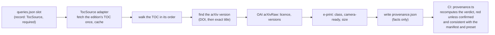

# Corpus provenance — design

What every paper of `fixtures/real-papers/accepted/` must be, which source of record says so, and how
CI holds that answer offline. It answers zernie/paperlint#716 and finds a larger cut than #716 names.

Evidence levels: **[A]** ran it or read the code line, **[B]** read a document, **[C]** inferred.
Measurements are of 2026-11-27, from a cloud container, on `origin/main` at `1b4e7a0`.

## 0. The decision in five lines

1. #716 is right that each kept paper needs one check against a source of record. It is the wrong cut
   on its own: it adds a check _after_ a collector that starts from what the paper says about itself,
   so every candidate still has to get through regexes before the check runs.
2. Invert the collector: **candidates come from the edition's table of contents (TOC), and arXiv is
   only where the source comes from.** Rule 1 ("was it accepted, at which edition, on which track") is
   then answered by the source of record. No acceptance regex is left.
3. **Store facts, not verdicts.** For each kept paper the collector writes the TOC entry it matched
   and the arXiv record it read the licence from. CI recomputes the verdict from those facts with a
   pure judge, so a hand-typed `"confirmed"` cannot pass.
4. A slot of `queries.json` must name its source of record (a zod discriminated union). An edition
   without one cannot be parsed, so the set cannot grow from self-description.
5. The licence leg is the strongest part of the foundation and stays on arXiv's OAI record. It needs
   stored evidence, and the six older papers need to be brought into the manifest.

## 1. Foundation audit

### 1.1 What each acceptance decision rests on

| decision                                               | rests on today                                                                                                                                                                            | kind                                                    | checked in CI by                                                                                                            | how a wrong paper is kept silently                                                                                                                                                                                                                                        |
| ------------------------------------------------------ | ----------------------------------------------------------------------------------------------------------------------------------------------------------------------------------------- | ------------------------------------------------------- | --------------------------------------------------------------------------------------------------------------------------- | ------------------------------------------------------------------------------------------------------------------------------------------------------------------------------------------------------------------------------------------------------------------------- |
| **venue** (accepted at all)                            | arXiv comment + journal-ref, by `POSITIVE`/`NEGATIVE` regexes (`rules.ts:89-92`, `judgeComment` `rules.ts:110`); or the Semantic Scholar venue string (`judgeListedVenue` `rules.ts:157`) | self-description (comment), or a third-party index (S2) | `balance.ts:49`: only that a quote is non-empty **or** `acceptance === "s2-venue-listing"`. The quote is never re-read. [A] | any comment holding a positive word and none of the negative ones. Measured: `Industry-Oral` passes because `\boral\b` is positive (§1.2) [A]                                                                                                                             |
| **edition** (year)                                     | regex for venue near `YY` in the comment (`rules.ts:110`); `otherYears` for S2 (`rules.ts:157`); `'YY` in `\acmConference` (`declared-venue.ts`)                                          | self-description                                        | nothing [A]                                                                                                                 | a non-ACM paper (90 `article`, 14 IEEE of 151 [A]) whose comment says the right year but whose S2 year is the publication year. `\acmConference` is read only from ACM preambles: 26 of 47 `acmart` papers declare one [A]                                                |
| **track** (main vs companion, industry, Findings, E&D) | `NEGATIVE` word list; `NOT_MAIN` (`declared-venue.ts:12`); `FINDINGS_SERIES` (`rules.ts:93`); `ONE_TRACK` for ASE 2026 only (`preset.ts:26`)                                              | self-description                                        | nothing [A]                                                                                                                 | any track word missing from the list. Measured: 6 industry-track papers and 2 NeurIPS E&D papers are in the set as the main track (§1.2) [A]                                                                                                                              |
| **licence**                                            | `<license>` of arXiv's OAI record (`sources.ts:230`), exact match against `LICENCES` (`rules.ts:34`)                                                                                      | **source of record**                                    | `balance.ts` → `committedLicenceProblems` on the manifest _string_ (`rules.ts:57`) [A]                                      | a hand-edited manifest string. The record read is not stored. The six older papers have no manifest entry, and `isArxivDir` (`balance.ts:38`) skips them, so no check covers their licence [A]                                                                            |
| **licence applies to the stored version**              | the feed's id is the latest version when the paper is fetched; OAI gives one licence per record (arXivRaw has no per-version licence) [A]                                                 | implicit                                                | nothing                                                                                                                     | arXiv lets a new version carry a different licence [C]. Sampled 11 of 151: all still have stored = latest version and the same licence [A]                                                                                                                                |
| **document class / template**                          | first `\documentclass` + style package (`rules.ts:258-275`)                                                                                                                               | the artefact itself (the TeX we lint)                   | nothing after collection [A]                                                                                                | not a provenance risk: the TeX _is_ the thing linted                                                                                                                                                                                                                      |
| **camera-ready vs submission/preprint**                | `reviewOpts` only for ACL, AAAI, IJCAI, CVPR, acmart; **none** for `neurips`, `icml`, `iclr`, `ieee` (`rules.ts:258-269`) [A]                                                             | the artefact itself                                     | nothing                                                                                                                     | a NeurIPS `[preprint]`, an ICML style without `[accepted]`, or an ICLR without `\iclrfinalcopy` passes rule 3. Measured: none in the set today (all 10 ICML have `[accepted]`, all 10 ICLR have `\iclrfinalcopy`, all 10 NeurIPS have `final`) [A]: luck, not a guarantee |
| **size**                                               | bytes of the kept text sources (`rules.ts:291`)                                                                                                                                           | the artefact                                            | nothing                                                                                                                     | n/a                                                                                                                                                                                                                                                                       |
| **preset chosen**                                      | `presetFor` from slot series+year, plus `ONE_TRACK` (`preset.ts:93`)                                                                                                                      | derived from the edition/track above                    | the baseline compares findings, not the choice                                                                              | a wrong track picks the edition preset of another track. Measured: 2 of 16 edition-preset papers (§1.2) [A]                                                                                                                                                               |

### 1.2 Measured on the corpus

- **157 papers in `accepted/`**: 151 with a `venue-manifest.json` entry, 6 older ones named by words,
  with no entry [A] (`ls`, manifest count).
- **How acceptance was established** (151 entries): `arxiv-comment` 122, `s2-venue-listing` 17, field
  absent (hand-chosen on 2026-11-19) 12 [A]. The 76 papers of 2026-11-20 were judged by
  `sampling/sample.mjs`, whose `NEGATIVE` has no symposium term and which never read `\acmConference`;
  the README says the later `judgeDeclaredVenue` was run over the 159 papers kept before it [B].
- **DOIs**: 2 of 151 manifest entries carry a DOI anywhere in their fields [A]. In the TeX, 31 papers
  have a real `\acmDOI` (30 in the manifest, plus `agenticdev-acm26`) and 3 more have a placeholder
  `XXXXXXX.XXXXXXX`; 123 have none [A].
- **Wrong track, kept as the main proceedings** [A]: the TOC is the record for the first, the comment
  for the rest:

  | paper                      | kept as                                          | what the record or the comment says                                                                                                                                          |
  | -------------------------- | ------------------------------------------------ | ---------------------------------------------------------------------------------------------------------------------------------------------------------------------------- |
  | 2604.08115v1               | ACL 2025                                         | Crossref: DOI `10.18653/v1/2025.acl-industry.100`; OpenAlex: «Volume 6: Industry Track». The comment, «ACL 2025 Industry-Oral», passed because `\boral\b` is a positive word |
  | 2509.18719v1               | ACL 2025                                         | «ACL 2025 industry track»; journal-ref «(Volume 6: Industry Track)»                                                                                                          |
  | 2602.22696v1               | EMNLP 2025                                       | «EMNLP 2025 Industry Track»                                                                                                                                                  |
  | 2509.16861v1               | ASE 2025                                         | «Industry Showcase Track»                                                                                                                                                    |
  | 2607.27374v2, 2607.06766v2 | ASE 2026                                         | «Industry Showcase» (hand-chosen; `ONE_TRACK` already routes them to the family preset)                                                                                      |
  | 2611.24904v1, 2611.34881v1 | NeurIPS 2026, linted as `paperlint:neurips-2026` | «Track on Evaluations and Datasets». `presets/neurips-2026.jsonc:1` is the Main Track                                                                                        |

  `NEGATIVE` (`rules.ts:91`) does not list «industry». No rule reads «Evaluations and Datasets» or the
  `eandd` style option, which 3 NeurIPS papers load [A].

- **Licence**: 144 CC BY, 5 CC BY-SA, 2 CC0 in the manifest [A]. The 11 papers re-read today from
  `oaipmh.arxiv.org` (arXivRaw) all have the recorded licence, and in all 11 the stored version is the
  latest one [A]. The README line «as the arXiv abstract page states» (`paper.ts:95`) is wrong about
  its source: the code reads the OAI record (`sources.ts:230`) [A].
- **Two licence tables**: `LICENCES` in `scripts/grow-real-papers/rules.ts` for the fixtures, and
  `src/domain/licence.ts` (SPDX ids, `read_from`/`read_at`) for consumer venue corpora
  (`docs/design/venue-corpus.md`) [A]. They describe the same fact twice.

### 1.3 The problems, ranked

1. **Rule 1 is decided by self-description, and nothing in CI re-judges it.** Track and edition are
   regex verdicts over a comment, an S2 string and an ACM preamble. Each review round on #711 added a
   word to the list. Measured: 8 papers are in the set on the wrong track, 2 of them linted against
   another track's edition preset [A]. This is the class in #716.
2. **CI holds verdicts, not evidence.** The manifest stores `license` and `accepted.quote` as strings.
   `balance.ts` checks that they exist and are well formed, and a typed string passes [A]. The six
   older papers are outside every licence check [A]. This is the licence P0 of
   `fixtures/real-papers/CLAUDE.md`: a mistake there is a copyright breach that a revert does not undo.
3. **Nothing enforces "camera-ready"** for 4 of the 14 class specs (`neurips`, `icml`, `iclr`, `ieee`,
   `rules.ts:258-269`) [A]. Today's set is clean on the first three only by luck [A]. A TOC check
   cannot fix this: the TOC says the paper was published, not that the arXiv version is the published one.

Lower: the 12 hand-chosen entries and the 6 older papers were judged by a person, with no log [B];
`PER_EDITION` counts a mislabelled track toward the wrong edition [C].

## 2. Sources of record, as measured from here

| source                                                                       | access from this container                                                                                                                                                                                                                                                                                                 | covers                                                                                                                                                                       | gives the track?                                                                                                                                                               |
| ---------------------------------------------------------------------------- | -------------------------------------------------------------------------------------------------------------------------------------------------------------------------------------------------------------------------------------------------------------------------------------------------------------------------- | ---------------------------------------------------------------------------------------------------------------------------------------------------------------------------- | ------------------------------------------------------------------------------------------------------------------------------------------------------------------------------ |
| **DBLP** (search API, per-volume XML; dblp.org, uni-trier, dagstuhl mirrors) | **blocked**: an Anubis «Making sure you're not a bot!» page, HTTP 202, with the default and with a project user agent [A]. Monthly dumps are DOIs `10.4230/dblp.xml.YYYY-MM-01` on DROPS; the latest is `2026-11-01` [A]. The download link is not in the page's HTML (probably JavaScript), and its size was not measured | all CS venues, each volume with a stable key (`conf/iclr/2025`)                                                                                                              | the volume key often separates companion, workshop and Findings volumes [C]                                                                                                    |
| **Crossref** `api.crossref.org`                                              | reachable, JSON, by DOI and by `query.bibliographic` [A]                                                                                                                                                                                                                                                                   | ACM including PACM journals, IEEE, ACL Anthology (`10.18653`), AAAI (`10.1609`), IJCAI (`10.24963`), NeurIPS 2025 (`10.52202`, «Advances in NeurIPS 38») [A, one paper each] | ACL: the DOI names the volume (`acl-industry`, `findings-acl`) [A]. ACM: `event.acronym` (`CHI '25`) and container title [A]. PACM: `issue` names the conference (`ISSTA`) [A] |
| **OpenAlex** `api.openalex.org`                                              | reachable [A]                                                                                                                                                                                                                                                                                                              | matched an ICML 2025 paper to «Proceedings of the 42nd ICML» (PMLR, no DOI) [A]. A USENIX Security paper is listed only as an arXiv preprint [A]                             | `raw_source_name` («Volume 6: Industry Track») [A]                                                                                                                             |
| **Venue sites**                                                              | `proceedings.mlr.press/v267/` 200; `proceedings.neurips.cc/…/2025` 200; `aclanthology.org/volumes/…` 200; `usenix.org/…/technical-sessions` 200, and it lists the probed paper [A]. OpenReview API: 403 `ChallengeRequiredError` [A]. `dl.acm.org`: 403 Cloudflare [A]                                                     | PMLR (ICML), USENIX (Security, OSDI, NSDI), ACL Anthology, NeurIPS                                                                                                           | ACL volume id; USENIX session pages; PMLR one volume per conference [C]                                                                                                        |
| **Semantic Scholar**                                                         | 429 on the first unauthenticated request [A]                                                                                                                                                                                                                                                                               | broad                                                                                                                                                                        | venue strings only: today's `judgeListedVenue` input                                                                                                                           |

Coverage of today's 50 editions, by series [C, from the publishers above]: Crossref with a DOI covers
about 110 of the 151 entries. The rest need ICLR (10, OpenReview is blocked → DBLP dump), ICML (10,
PMLR), USENIX Security, OSDI and NSDI (17, usenix.org), and CVPR and ICCV (4, CVF open access, IEEE
DOIs later). Editions not yet published (NeurIPS 2026 meets in December) are not indexed anywhere yet
(§3, `not-indexed-yet`). The spike (§9) measures this table.

**Choice.** One port, `TocSource`, with an adapter per publisher: Crossref first (the most editions,
plain JSON, CC0 metadata); then PMLR, USENIX and ACL Anthology pages; the DBLP monthly dump as the
fallback for what no other adapter reaches (ICLR). DBLP's live API is out while Anubis blocks it, and
we do not work around the challenge.

## 3. The verdict model

The judge is a pure function, `(facts, editionMap) → Provenance`, with an exhaustive `switch` at each
consumer. The verdict is never stored. Only `facts` are.

```ts
type TocRef = Readonly<{ source: TocSourceKind; id: string; volume: string }>; // DOI or URL; the volume as the source names it

type Provenance =
  | {
      kind: "confirmed";
      toc: TocRef;
      edition: Edition;
      track: Track;
      matchedBy: "doi" | "title";
    }
  | { kind: "other-track"; toc: TocRef; edition: Edition; track: Track } // in the proceedings, not the track the slot/preset covers
  | { kind: "other-edition"; toc: TocRef; edition: Edition } // in the series, another year
  | { kind: "not-in-toc"; toc: TocSnapshotRef; entries: number } // the TOC is complete and the paper is not in it
  | { kind: "not-indexed-yet"; edition: Edition; source: TocSourceKind } // the source has no volume for this edition
  | { kind: "ambiguous"; candidates: readonly TocRef[] } // two or more title matches: a person decides
  | { kind: "unreachable"; source: TocSourceKind; status: string }; // collector-time only; never written to the record
```

- `accepted/` admits **`confirmed` only**. `ambiguous`, `not-in-toc`, `other-*` reject, with the
  reason logged. `unreachable` is retried on the next run (as `download failed` is today,
  `collect.ts` `stateOf`). `not-indexed-yet` is the open decision of §10.
- `Track` is a closed enum per edition in the edition map (`main`, `findings`, `industry`, `e-and-d`,
  …). Each track names the preset that covers it, or `family`. This replaces `ONE_TRACK`
  (`preset.ts:26`) and `FINDINGS_SERIES` (`rules.ts:93`) with data.
- The edition map lives on the slot: `queries.json` gains a required
  `record: { kind: "crossref-container", container, event? } | { kind: "crossref-doi-prefix", prefix } | { kind: "crossref-issn-issue", issn, issue } | { kind: "pmlr", volume } | { kind: "usenix", page } | { kind: "acl-anthology", volumes: Record<Track, string> } | { kind: "dblp-dump", key }`.
  A slot with no `record` does not parse.

## 4. Title matching

The order of evidence, strongest first; the first that decides wins:

1. **DOI equality.** A DOI from `\acmDOI` (31 papers [A]), from the arXiv `<doi>` field, or from the
   journal-ref, against the TOC entry's DOI. An exact match is `matchedBy: "doi"`.
2. **Normalised title equality.** NFKC, LaTeX macros and braces stripped, case folded, punctuation
   and whitespace collapsed. «Revise: …» matches «REVISE: …» [A].
3. **A near title plus an author.** Token Jaccard ≥ 0.9 **and** the first author's surname is in the
   TOC entry's authors. Below that, or with two candidates, the verdict is `ambiguous`. A camera-ready
   title often differs from the arXiv one, so a miss here is not `not-in-toc` unless the TOC was
   searched in full (§5).

Matching runs locally against a stored TOC snapshot, never as one search per candidate. A
`query.bibliographic` search is fuzzy: for the ICML probe its first hit was an unrelated ACL Findings
paper [A]. It is used only to find a DOI, and the DOI is then checked against the volume.

## 5. Caching and rate limits

- **One fetch per edition**, not per candidate. The adapter pages through the whole volume (Crossref
  `filter=container-title:…` or a DOI prefix, cursor paging; a PMLR or USENIX page; a DBLP dump
  slice), writes the snapshot `{source, query, fetched_at, entries[], sha256}` to a git-ignored cache
  (`node_modules/.cache/grow-real-papers/toc/<series>-<year>.json`), and reuses it for 30 days.
  `not-in-toc` is only allowed when the snapshot says the paging completed (`complete: true`).
- Requests go through the existing `throttledGet` (`http.ts`), with a per-host gap. Crossref is used
  without a `mailto` (no personal contact goes into a request) and with a project user agent that
  names the repository. Its public pool is enough for one request per page [C].
- The DBLP dump is about 1 GB compressed [C, not measured]. It is downloaded once per month into the
  cache, and only when an edition's `record.kind` is `dblp-dump`.

## 6. How offline CI holds the result

The house rule: **the script produces facts into a JSON file, and a check judges that file.**

- **Producer**: the collector, and `main.ts --recheck`, write `accepted/<id>/provenance.json`, one per
  paper:
  `{ schema: 1, arxiv: { id, versions: [{v, date}], licence, oai_datestamp, read_at }, toc: { source, query, volume, entry: <the raw TOC record, as returned>, snapshot_sha256, entries, complete, read_at }, match: { by, title_ours, title_toc } }`.
  It is a few KB (Crossref and DBLP metadata are CC0 [B]). It is marked `linguist-generated`.
- **Judge**: `fixtures/real-papers/provenance.ts`, beside `balance.ts`, with a test of both halves.
  It parses each record with zod, recomputes `Provenance` with the same pure judge the collector
  uses, and requires the following for every directory of `accepted/`, the six older ones included:
  `confirmed`; manifest `series`/`year`/`track` equal to the verdict's; the manifest `preset` equal to
  what `presetFor` derives from that track; `arxiv.licence` in the licence table; the stored version
  equal to the last of `arxiv.versions`. `balance.ts`'s quote and listing checks are deleted.
- **Why a test and not an ESLint rule**: the subject is the fixtures, not a consumer's paper, and its
  siblings (`balance.test.ts`, `inputs.test.ts`) are tests [A]. If the corpus checks ever move into
  the engine, this one moves with them.
- **What CI cannot see**: whether the stored TOC entry is what the source returns today. The
  collector's `--verify` re-fetches and compares `snapshot_sha256` locally, as `arxiv-fetch.ts` does
  for the sources.



## 7. What happens to the existing regexes

| code                                                                                          | fate                                                                                                                                                                            | why                                                                                                                                       |
| --------------------------------------------------------------------------------------------- | ------------------------------------------------------------------------------------------------------------------------------------------------------------------------------- | ----------------------------------------------------------------------------------------------------------------------------------------- |
| `POSITIVE`, `NEGATIVE`, the workshop regex, `judgeComment` (`rules.ts:89-137`)                | **deleted**                                                                                                                                                                     | the TOC decides acceptance, edition and track. With the inverted walk, no candidate comes from a comment search                           |
| `judgeListedVenue`, `otherYears` (`rules.ts:140-172`), `s2Candidates`, `s2Url` (`sources.ts`) | **deleted**                                                                                                                                                                     | S2 venue strings are a third-party guess. The TOC replaces them                                                                           |
| `judgeDeclaredVenue`, `NOT_MAIN` (`declared-venue.ts`)                                        | **deleted**                                                                                                                                                                     | it is self-description. A paper whose TeX says `CHI EA '26` is absent from the main TOC, or present in a companion volume (`other-track`) |
| `FINDINGS_SERIES`, `ONE_TRACK`                                                                | **become data**: `Track` in the edition map                                                                                                                                     | the track comes from the volume                                                                                                           |
| `arxivCandidates` (comment search)                                                            | **kept only as a fallback candidate source** for an edition with `not-indexed-yet`, if §10 admits that state; otherwise deleted                                                 |                                                                                                                                           |
| `CLASS_SPECS`, `judgeClass`, `withStyle`, `ofClass` (`rules.ts:257-289`)                      | **kept and tightened**: `neurips` requires `final` and rejects `preprint`; `icml` requires `accepted`; `iclr` requires `\iclrfinalcopy`; `ieee` records `camera-ready: unknown` | the TeX is the artefact itself, so this is not self-description. The TOC cannot say which arXiv version is the camera-ready               |
| `judgeLicence`, `LICENCES`                                                                    | **kept**; the table merges into `src/domain/licence.ts`                                                                                                                         | arXiv's record is the source of record. One licence table, not two                                                                        |
| `judgeSize`, `TEXT_EXT`, `PER_EDITION`                                                        | kept                                                                                                                                                                            | not provenance                                                                                                                            |

## 8. Re-checking the 157 papers already in `accepted/`

1. `main.ts --recheck` (no `--write` means a dry run) runs the judge over every directory, the six
   older ones included. It prints one line per paper with its verdict and writes `provenance.json` for
   each. A paper that is not `confirmed` gets no record.
2. A ratchet list, `accepted/sampling/provenance-pending.json`, holds the ids with no record yet. It
   may only shrink, the pattern of `eslint-suppressions.json`. The judge requires a record for every
   directory not on it, so the PR that adds the judge does not have to re-check 157 papers at once.
3. The papers that come out `other-track`, `other-edition` or `not-in-toc` are removed in their own
   PR. Their slots are refilled by the next collector run. Expected from §1.2: at least the 6
   industry-track papers. The 2 NeurIPS E&D papers either move to an `e-and-d` track with the family
   preset, or are removed.
4. The six older papers get manifest entries: versioned id, `source_sha256`, licence. Their e-prints
   are unversioned today (`arxiv.org/e-print/2409.18213`) [A].

## 9. What this change can break (P0), and what is impossible by construction

**P0 of this change:**

- **A paper under a licence that forbids redistribution is committed or kept.** It cannot be undone
  by a revert (`fixtures/real-papers/CLAUDE.md`).
- **Silent loss of corpus papers.** A re-check with a broken matcher or an unreachable source removes
  papers that were right, and the calibration of the opt-in thresholds and the baselines moves with
  them. A paper rejected for a wrong reason is the same failure as a wrong paper kept.
- **CI turns red for a reason outside the repository.** Avoided: CI reads only committed files.

**Made impossible:**

| state                                     | how                                                                                                     |
| ----------------------------------------- | ------------------------------------------------------------------------------------------------------- |
| an edition grows from self-description    | `record` is required in `SlotSchema`. A slot without it does not parse                                  |
| a verdict typed by hand passes CI         | no verdict is stored. CI recomputes it from the raw TOC entry and the arXiv record                      |
| a paper outside every check               | the judge iterates over **directories**, not over manifest entries, so the six older papers are covered |
| removal on `unreachable`                  | `unreachable` has no record form, so it can only mean "retry"                                           |
| one licence table drifting from the other | one table, `src/domain/licence.ts`                                                                      |

**Still a check, not a construction:** the `--recheck` dry run must report verdict counts before any
removal. The removal PR lists every removed id with its verdict and the TOC entry, and a person reads it.

## 10. Open decision: editions that are not indexed yet

The presets that matter most are for coming editions (`neurips-2026`, `emnlp-2026`), and their
proceedings do not exist yet. Three options:

| option                                                                                                                             | cost                                                                                                                    |
| ---------------------------------------------------------------------------------------------------------------------------------- | ----------------------------------------------------------------------------------------------------------------------- |
| **A. Admit only `confirmed`.** Upcoming editions wait for their proceedings                                                        | the newest presets get no camera-ready papers until the proceedings are out (NeurIPS: weeks after the conference)       |
| **B. The venue's own accepted-papers list counts as a TOC** (OpenReview venue id, the NeurIPS virtual site, the ACL accepted list) | each list needs an adapter, and OpenReview answers 403 from here [A]. Recommended if the spike finds one reachable list |
| **C. `provisional` from self-description, re-checked later**                                                                       | this is today's failure class with a deadline attached, and a time-based CI check is not hermetic                       |

Recommendation: **A now, B per venue when an adapter is reachable.** Never C.

## 11. Pull requests

Each one is a single concern that can be reverted on its own, at most about 1000 changed lines.

| #   | title                                                                             | concern                                                                                                      | depends on |
| --- | --------------------------------------------------------------------------------- | ------------------------------------------------------------------------------------------------------------ | ---------- |
| 0   | (spike, no PR)                                                                    | §12; the measured coverage table replaces the [C] rows of §2 here                                            | —          |
| 1   | `fix(grow-real-papers): require the camera-ready option of each style`            | `neurips` final, `icml` accepted, `iclr` `\iclrfinalcopy`, IEEE `unknown`. Tests of both halves              | —          |
| 2   | `refactor(corpus): one licence table`                                             | `LICENCES` → `src/domain/licence.ts`; fix the README's «abstract page» line                                  | —          |
| 3   | `test(corpus): provenance record and judge, behind a shrinking pending list`      | schema, pure judge, `provenance.ts` + test, the 6 older papers in the manifest, every id pending             | 2          |
| 4   | `feat(grow-real-papers): TocSource port, Crossref adapter, title matcher, cache`  | the port, one adapter, the matcher, the snapshot cache, `--recheck` dry run                                  | 3          |
| 5   | `feat(grow-real-papers): PMLR, USENIX and ACL Anthology adapters`                 | the non-Crossref editions; DBLP dump only if the spike needs it for ICLR                                     | 4          |
| 6   | `test(corpus): record provenance of the papers already kept`                      | `provenance.json` per confirmed paper; the pending list shrinks. Generated data                              | 5          |
| 7   | `test(corpus): remove papers the proceedings do not hold`                         | the removals, each listed with its verdict; README updated                                                   | 6          |
| 8   | `refactor(grow-real-papers)!: walk the table of contents, not the comment search` | inverted walk; `record` required on slots; delete the regexes of §7. `!` only if the collector's CLI changes | 6          |
| 9   | `test(corpus): refill the quotas from the TOC walk`                               | a collector run; generated papers                                                                            | 7, 8       |

PR 8 is the large deletion. If it goes over the cap, the S2 removal splits into its own PR.

## 12. First spike (~30 minutes): does a reachable source decide most papers?

**The riskiest unknown** is coverage. If Crossref, PMLR, USENIX and the ACL Anthology together cannot
give a decisive verdict (`confirmed`, `other-track` or `not-in-toc`) for most of the 151 manifest
papers, the design depends on DBLP, which is blocked here, and §2's choice changes.

Steps, in a scratch directory, with nothing committed:

1. For each manifest entry, take a DOI from `\acmDOI`, the arXiv `<doi>` or the journal-ref; otherwise
   take the title from the README.
2. Crossref: a DOI lookup, or the top `query.bibliographic` hit checked by normalised title. Record
   the container, event, issue and DOI. One request per second.
3. For ICML, ICLR and USENIX, one page fetch per edition (PMLR volume, usenix.org technical sessions)
   and a local title match.
4. Print a table, series × {confirmed, other-track, not-found, not-indexed-yet, unreachable}, and list
   every non-confirmed paper with its raw record.
5. Fetch the HTTP headers of the DROPS dump file, if the spike can find its link, to settle the size.

**Decision rule**: if ≥ 85% of the 151 are decided without DBLP, build PR 4–5 as written. If fewer,
the DBLP dump adapter moves into PR 4, and its size and parse time become the next spike.

## 13. Where I may be wrong

- **"Main proceedings" is a track, not a volume.** ASE's Industry Showcase is in the ASE proceedings
  [C], and NeurIPS E&D shares the «Advances in NeurIPS» volume with the main track [C]. For those, the
  TOC confirms "in the proceedings" but not the track, and the track is still read from the paper's
  self-description (comment or `eandd`). The edition map can mark such tracks as indistinguishable;
  the judge then refuses the edition preset and uses the family.
- **The coverage numbers of §2 are inferred** from publishers, with one probe each. The spike measures them.
- **arXiv licences per version.** I read that OAI's arXivRaw has a single `<license>` [A]. I did not
  verify that an older version keeps its own licence when a newer one changes it [C]. The rule "stored
  version = last version" is safe either way, but it rejects a paper that merely gained a v3.
- **The TOC walk changes the sample.** Walking the proceedings in TOC order and keeping the first
  papers with a CC licence and an arXiv source samples differently from the comment search. The
  calibration of the opt-in thresholds may shift for that reason alone, separate from any defect fix.
- **Crossref title search is fuzzy.** The matcher's thresholds (Jaccard 0.9 plus an author) are a
  guess until the spike's raw hits are read.
- **The DBLP dump size (~1 GB) is from memory**, not measured. The DROPS page gave no link in its HTML.
- **The 8 wrong-track papers are a lower bound.** I scanned the 151 quotes for track words. A comment
  that names no track at all (S2-listed papers, 17) was not checked against a TOC.
- **The six older papers** may be checked by something I did not find. I searched for their names in
  `*.ts` and `*.json` and found only the lint and e2e uses.
