# Where things live, and what checks them when

A paper moves through eight stages ([the flow](#the-flow)). Each stage writes into one
place, and a check guards that place. This page is the map: the places, who writes each one, and the
moment each check runs. The skills, stage by stage: [`skills.md`](skills.md).

## The flow

Each box names the stage's skills, what it writes, and what checks it. Stage 3 is drawn from the
inside: a study's pre-registration and its human labels are made there.

```mermaid
flowchart TB
  N["<b>paperlint new</b><br/>creates the paper folder<br/>checked from here on:<br/>every lint · paper/allowed-files-only<br/>every new file · hook paper-folder-layout"]
  S1["<b>1 · idea</b><br/>research-ideate · map-prior-work<br/>analyze-sibling-paper<br/>writes: siblings/<br/>checked by: sibling/frontmatter"]
  S2["<b>2 · venue</b><br/>find-venue · plan-paper-timeline<br/>study-accepted-papers, mode A or B<br/>writes: paperlint.json, a report in reviews/<br/>checked by: review/frontmatter"]
  V[("<b>#lt;papers-root#gt;/venues/#lt;venue#gt;/</b><br/>beside the papers, not in one:<br/>the venue's accepted papers,<br/>shared by every paper aimed at it<br/>checked by: nothing")]
  subgraph S3["3 · study: repro/#lt;id#gt;-#lt;slug#gt;/"]
    direction TB
    D["<b>design</b> · build-benchmark<br/>paperlint studies new<br/>writes: the study's folder, README.md,<br/>its row in repro/studies.json<br/>checked by: repro/allowed-files-only,<br/>repro/study-registered"]
    P["<b>plan</b> · build-benchmark<br/>fills: plan.json, before the draw<br/>checked by: repro/study-registered,<br/>once the study runs"]
    A["<b>author check</b> · you see the drawn units<br/>writes: author_check in plan.json<br/>checked by: repro/study-registered,<br/>for a headline measurement"]
    R["<b>run</b> · your scripts<br/>writes: the study folder,<br/>repro/tools/, repro/data/<br/>checked by: repro/allowed-files-only"]
    L["<b>labels</b> · build-label-page<br/>a phone page; the answers go<br/>into the study's data/"]
    Y["<b>analysis</b> · build-benchmark<br/>writes: the numbers, NOTES.md,<br/>the study's row: status, result<br/>then paperlint studies index<br/>checked by: repro/study-registered"]
    D --> P --> A --> R --> L --> Y
  end
  S4["<b>4 · draft</b><br/>draft-paper · argument-arc · tighten-paper<br/>writes: paper.tex, sections/, figures/<br/>checked by: the tex/* rules<br/>hook paper-edit-guard: no shell writes"]
  S5["<b>5 · review</b><br/>grade-paper-writing · verify-citations<br/>pc-panel-review · harden-paper<br/>study-accepted-papers, mode C or D<br/>writes: reviews/, the scorecard<br/>in PIPELINE-STATUS.md<br/>checked by: review/frontmatter"]
  S6["<b>6 · submit</b><br/>paperlint build · submit-paper<br/>writes: paper.pdf, _build/,<br/>versions/, submission/<br/>checked by: format/page-limit, pdf/*,<br/>anonymity/identity, paper/stages"]
  S7["<b>7 · camera-ready</b><br/>camera-ready<br/>writes: versions/, talk/<br/>checked by: paper/stages, talk/*"]
  S8["<b>8 · extend</b><br/>extend-paper<br/>writes: a new paper folder"]
  N --> S1 --> S2 --> D
  Y --> S4 --> S5 --> S6 --> S7 --> S8
  S2 -. fills .-> V
  V -. read again .-> S5
```



The cylinder is a venue's corpus of accepted papers: it lives beside the papers, not inside one
([`venues.md`](venues.md)).

## The map

The papers directory is `papersDir` in the project's `paperlint.json` (default `papers/`). A folder
in it is a paper when it holds `PIPELINE-STATUS.md`, `paper.tex` or `paperlint.json`; `paperlint new`
creates one.

<!-- layout:begin — drawn from src/domain/paper-layout.ts (PAPERS_LAYOUT_TREE); src/layout-docs.test.ts fails when this block differs -->

```text
<papers-root>/
├── venues/                            ← outside every paper folder: one folder per venue
│   └── <venue>/                       ← that venue's accepted papers, shared by every paper aimed at it
└── <paper>/                           ← one folder per paper, named after the work; its root holds only what is below
    ├── PIPELINE-STATUS.md             ← the paper's one live-state file: stages, plan, scorecard
    ├── paper.tex                      ← the source; `paperlint build` compiles it
    ├── paperlint.json                 ← the paper's settings
    ├── README.md                      ← what the paper is
    ├── CLAUDE.md                      ← the paper's agent rules
    ├── CLAIMS.md                      ← the claims ledger
    ├── NOTES.md                       ← each number in the paper → the data it comes from
    ├── SUBMIT-CHECKLIST.md            ← the venue's format and submission mechanics
    ├── .gitignore                     ← keeps the build's byproducts out of git
    ├── paper.pdf                      ← the built PDF
    ├── *.tex *.bib *.cls *.sty *.bst  ← what TeX and bibtex look up beside paper.tex
    ├── _build/                        ← the facts `paperlint build` writes
    ├── versions/                      ← each stage's frozen PDF and source
    ├── reviews/                       ← dated reviews and pass reports
    ├── siblings/                      ← the cards of competing papers
    ├── research/                      ← dated research and decision records
    ├── repro/                         ← the reproduction artifact
    │   ├── README.md                  ← the index: one line per study, generated from studies.json
    │   ├── studies.json               ← the study registry: id, title, status and result of each study
    │   ├── .gitignore                 ← keeps the scripts' byproducts out of git
    │   ├── tools/                     ← scripts used across the paper (numbers, figures, anonymity check, harnesses)
    │   ├── data/                      ← shared data (tables, caches)
    │   └── <id>-<slug>/               ← one folder per study or spike, named by its row in studies.json (P1-S03-baseline)
    │       └── README.md              ← required: what it asks, how to run it, what it found
    ├── figures/                       ← graphics and their sources
    ├── sections/                      ← the body, when it is split
    ├── talk/                          ← the talk's files
    ├── submission/                    ← forms, portal records, mail with the venue, the anonymized upload
    └── extra/                         ← anything; never judged
```

<!-- layout:end -->

Two places with similar names are not in this drawing:

- `venues/` at the **project root** holds your own venue presets and their cards
  (`venues/<name>.jsonc`, `venues/<name>.md`), for a venue paperlint does not ship.
- `<papers-root>/venues/<venue>/` (drawn above) holds a venue's **accepted papers**.

Both are explained in [`venues.md`](venues.md).

## Each place: who writes it, and what checks it

"Stage" is the stage of [the pipeline](#the-flow) that writes the place first.
"Checked by" is the rule `paperlint lint` runs over it; "nothing" means no rule reads its content.

| place                                    | stage            | written by                                                                                                                                                                                       | checked by                                                                                                                                                               |
| ---------------------------------------- | ---------------- | ------------------------------------------------------------------------------------------------------------------------------------------------------------------------------------------------ | ------------------------------------------------------------------------------------------------------------------------------------------------------------------------ |
| `<papers-root>/venues/<venue>/`          | 2 venue          | `study-accepted-papers`, its first run for that venue (mode A, usually)                                                                                                                          | nothing ([why](venues.md#what-checks-it))                                                                                                                                |
| the paper folder's root                  | before 1         | `paperlint new`: the three files, and an empty `.gitkeep` folder for `reviews/`, `research/`, `figures/`, `versions/`, `submission/`, `repro/tools/`, `repro/data/` (`repro/` gets a stub index) | [`paper/allowed-files-only`](rules/paper/allowed-files-only.md); the hook `paper-folder-layout` refuses a new stray entry                                                |
| `PIPELINE-STATUS.md`                     | every stage      | `paperlint new`, then `paper-pipeline`, `paper-status`; `study-accepted-papers` (the scorecard)                                                                                                  | `paper/stages`, `paper/source`, [`cycle/stage`](rules/cycle/stage.md) ([rules](rules.md))                                                                                |
| `paperlint.json`                         | before 1, then 2 | `paperlint new`; `find-venue` names the venue                                                                                                                                                    | `paperlint lint` refuses an unknown key; [`cycle/record`](rules/cycle/record.md)                                                                                         |
| `siblings/`                              | 1 idea           | `map-prior-work`, `analyze-sibling-paper`                                                                                                                                                        | `sibling/frontmatter` ([records](configuration.md#records-in-frontmatter-checked-by-shipped-json-schemas))                                                               |
| `reviews/`                               | 2, then 4–5      | `study-accepted-papers` (its report), `grade-paper-writing`, `cold-read-diff`, the review skills                                                                                                 | `review/frontmatter` ([records](configuration.md#records-in-frontmatter-checked-by-shipped-json-schemas))                                                                |
| `research/`                              | any              | you and the skills: dated research and decision records                                                                                                                                          | nothing                                                                                                                                                                  |
| `repro/`, its top                        | 3 study          | `build-benchmark`, your scripts                                                                                                                                                                  | [`repro/allowed-files-only`](rules/repro/allowed-files-only.md); the hook `paper-folder-layout` refuses a new loose entry                                                |
| `repro/studies.json`                     | 3 study          | `paperlint studies new` appends a row; you edit a row when its study ends; `paperlint studies index` regenerates the index in `repro/README.md`                                                  | [`repro/study-registered`](rules/repro/study-registered.md): a row per study folder, its fields, the index in sync                                                       |
| `repro/<id>-<slug>/`                     | 3 study          | `paperlint studies new` (the folder and its `README.md`), then `build-benchmark` (the design, in its `README.md`)                                                                                | [`repro/allowed-files-only`](rules/repro/allowed-files-only.md): the name, and a `README.md` in it; [`repro/study-registered`](rules/repro/study-registered.md): its row |
| `repro/<id>-<slug>/plan.json`            | 3 study          | `paperlint studies new` writes the template; `build-benchmark` fills it before the sample is drawn; you add the author's check                                                                   | [`repro/study-registered`](rules/repro/study-registered.md): its fields, filled once the study runs, and `author_check` in a headline measurement                        |
| `repro/<id>-<slug>/prereg.json`          | 3 study          | the plan's old name, still read when the row names it                                                                                                                                            | [`repro/study-plan-name`](rules/repro/study-plan-name.md) (warning); [`study/declare-sample`](rules/study/declare-sample.md), off by default                             |
| `repro/<id>-<slug>/decision.md`          | 3 study          | you: the decisions on the inputs of a study decided before its run, committed before the run (`paperlint studies gate`); the plan names it, and it may live elsewhere in the paper               | [`repro/outputs-before-decision`](rules/repro/outputs-before-decision.md)                                                                                                |
| `repro/<id>-<slug>/sealed.json`, `*.age` | 3 study          | `paperlint studies seal`, for a blind study (its mode is `blind`): the results encrypted with age, and their sha256                                                                              | [`repro/blind-plaintext`](rules/repro/blind-plaintext.md)                                                                                                                |
| `repro/<id>-<slug>/data/`                | 3 study          | `build-label-page` exports the labels here                                                                                                                                                       | nothing                                                                                                                                                                  |
| `repro/tools/`, `repro/data/`            | 3 study          | your scripts; `paperlint build` keeps `repro/data/references-cache.json`                                                                                                                         | nothing inside them                                                                                                                                                      |
| `NOTES.md`                               | 3, then 4        | you: each number → the data it comes from; `build-label-page` adds a line per label file                                                                                                         | nothing                                                                                                                                                                  |
| `paper.tex`, `sections/`, `*.bib`        | 4 draft          | `draft-paper`, `argument-arc`, `tighten-paper`                                                                                                                                                   | the `tex/*`, `paper/*` and `bib/*` rules ([rules](rules.md)); the hook `paper-edit-guard` refuses a shell write                                                          |
| `CLAIMS.md`, `figures/`                  | 4 draft          | you                                                                                                                                                                                              | nothing                                                                                                                                                                  |
| `paper.pdf`, `_build/`                   | 6 submit         | `paperlint build`                                                                                                                                                                                | `pdf/*`, [`format/page-limit`](rules/format/page-limit.md), [`anonymity/identity`](rules/anonymity/identity.md), the reference rules                                     |
| `versions/`                              | 6, then 7        | you, at submission and at camera-ready (`submit-paper` says how): the frozen PDF and source of each stage                                                                                        | `paper/stages`, `paper/source`                                                                                                                                           |
| `submission/`, `SUBMIT-CHECKLIST.md`     | 6 submit         | you, while `submit-paper` and `submission-portal` do the submitting: forms, portal records, mail with the venue                                                                                  | [`cycle/evidence`](rules/cycle/evidence.md), for the files a closed cycle names                                                                                          |
| `talk/`                                  | 7 camera-ready   | you                                                                                                                                                                                              | the `talk/*` rules ([talk](talk.md))                                                                                                                                     |
| `extra/`                                 | any              | you                                                                                                                                                                                              | nothing, ever                                                                                                                                                            |

## What runs when

A check runs at one of four moments:

- **Before a write** — a Claude Code hook. It sees an agent's Edit or Write, not a shell `mv` or a
  script, so it saves a round trip and guarantees nothing.
- **On lint** — `paperlint lint`, when you run it. Every rule runs, whatever wrote the files. This is
  the guarantee. No hook runs it for you.
- **In CI** — the same lint, on every push, if the project has the workflow `paperlint init` offers.
  The lint-only job skips what needs a build (pages, fonts, references).
- **On demand** — a skill, when you ask for what it does. A skill stops nothing; it writes.

| what                                                                                        | kind  | when it runs                                                | what it stops                                                                                                                                             |
| ------------------------------------------------------------------------------------------- | ----- | ----------------------------------------------------------- | --------------------------------------------------------------------------------------------------------------------------------------------------------- |
| `paper-folder-layout`                                                                       | hook  | before an agent creates a file (Edit, Write)                | a new entry the layout does not allow, at a paper's root or the top of its `repro/`; never an existing file                                               |
| `paper-edit-guard`                                                                          | hook  | before an agent's shell command                             | a shell command that writes or moves a paper's source, which would skip the hooks that run after an edit                                                  |
| `paper-skills-nudge`                                                                        | hook  | after an agent edits a paper's source                       | nothing: it shows the agent the pre-submit checklist                                                                                                      |
| `paper-status-gates`                                                                        | hook  | after an agent edits a paper's source                       | nothing: it prints the paper's readiness and its unrun gates, for a person reading the transcript                                                         |
| [`paper/allowed-files-only`](rules/paper/allowed-files-only.md)                             | rule  | every `paperlint lint`, and CI                              | a stray file or folder at a paper's root (error)                                                                                                          |
| [`repro/allowed-files-only`](rules/repro/allowed-files-only.md)                             | rule  | every `paperlint lint`, and CI                              | a loose entry at the top of `repro/`, a folder that is not a study's, a study folder without `README.md` (error)                                          |
| [`repro/study-registered`](rules/repro/study-registered.md)                                 | rule  | every `paperlint lint`, and CI                              | a study folder without its row in `repro/studies.json`, a row that does not match, a measurement or plan that does not hold, an index out of sync (error) |
| [`repro/study-plan-name`](rules/repro/study-plan-name.md)                                   | rule  | every `paperlint lint`, and CI                              | nothing: it warns when a study's plan is still named `prereg.json`                                                                                        |
| [`repro/blind-plaintext`](rules/repro/blind-plaintext.md)                                   | rule  | every `paperlint lint`, and CI                              | a plaintext result of a blind study that is still sealed                                                                                                  |
| [`study/declare-sample`](rules/study/declare-sample.md)                                     | rule  | every `paperlint lint`, and CI, once a paper turns it on    | a study's `prereg.json` without its population, strata, screens, coverage or the author's check (experimental, off by default)                            |
| [`paper/folder-venue-leftover`](rules/paper/folder-venue-leftover.md)                       | rule  | every `paperlint lint`, and CI                              | nothing: it warns when the folder is named after another venue                                                                                            |
| `review/frontmatter`, `sibling/frontmatter`                                                 | rule  | every `paperlint lint`, and CI                              | a review whose findings break the schema (error); a sibling card that does not say how much was read (warning)                                            |
| `paper/stages`, `paper/source`                                                              | rule  | every `paperlint lint`, and CI                              | a stage whose frozen PDF or source is missing or changed (error)                                                                                          |
| the rules on the source (`tex/*`, `paper/*`, `bib/*`)                                       | rule  | every `paperlint lint`, and CI                              | what each one's [row](rules.md) says                                                                                                                      |
| the rules on what `paperlint build` measured (`pdf/*`, `format/page-limit`, the references) | rule  | every `paperlint lint` after a build; CI's full job         | a PDF over the page limit, in the wrong font or format, or with a bad reference                                                                           |
| `study-accepted-papers`                                                                     | skill | when you ask; stage 2 (modes A, B) and stage 5 (modes C, D) | nothing: it fills the venue's corpus, and writes the strong-accept scorecard in `PIPELINE-STATUS.md`                                                      |
| `build-benchmark`                                                                           | skill | when you ask; stage 3                                       | nothing: it registers the study with `paperlint studies new`, writes its design, fills its `plan.json`, and updates its row when it ends                  |
| `build-label-page`                                                                          | skill | when you ask; stage 3                                       | nothing: it builds the labelling page, and exports the answers into the study's `data/`                                                                   |

The hooks are wired by `paperlint init` ([`install.md`](install.md)). A rule's level and options:
[`rules.md`](rules.md).
