# The skill pipeline

<!-- Generated by `npm run pipeline` from each skill's `flow` export and `skills/jobs.ts`. Do not edit by hand. -->

Who hands work to whom, read from the skills themselves: each `skills/<name>/SKILL.md.spec.ts`
exports `flow` (its stage, the skills its text hands work to, the skills it sends work back to),
and `skills/jobs.ts` names the one owner of each job on a paper's text, listed in its box.
A solid arrow hands work on (90); a dashed arrow loops back to a skill that runs earlier (21).
`test/pipeline.test.ts` fails on a cycle of solid arrows, an arrow the skill's own text never
names, a job without an owner, and this file when it is stale. The stages are those of
[`skills.md`](skills.md).

```mermaid
flowchart TB
  subgraph stage_across["Across every stage"]
    paper_pipeline["<b>paper-pipeline</b><br/>which stage runs next"]
    paper_status["<b>paper-status</b>"]
  end
  subgraph stage_idea["1 · Idea"]
    analyze_sibling_paper["<b>analyze-sibling-paper</b>"]
    map_prior_work["<b>map-prior-work</b>"]
    research_ideate["<b>research-ideate</b>"]
    sweep_design_space["<b>sweep-design-space</b>"]
  end
  subgraph stage_venue["2 · Venue"]
    find_venue["<b>find-venue</b>"]
    plan_paper_timeline["<b>plan-paper-timeline</b>"]
    study_accepted_papers["<b>study-accepted-papers</b>"]
  end
  subgraph stage_study["3 · Study"]
    build_benchmark["<b>build-benchmark</b>"]
    build_label_page["<b>build-label-page</b>"]
    label_agent_runs["<b>label-agent-runs</b>"]
    run_agent_grid["<b>run-agent-grid</b>"]
  end
  subgraph stage_draft["4 · Draft"]
    argument_arc["<b>argument-arc</b><br/>the order of the argument<br/>judge headings (the headings as a set)<br/>one name for one thing across the paper (the name budget)"]
    cold_read_diff["<b>cold-read-diff</b><br/>find unclear sentences (the last edit)<br/>judge headings (a heading in the last edit)"]
    draft_paper["<b>draft-paper</b>"]
    render_paper["<b>render-paper</b>"]
    rewrite_unclear["<b>rewrite-unclear</b><br/>rewrite for clarity<br/>fix a heading or a name"]
    tighten_paper["<b>tighten-paper</b><br/>cut for length"]
  end
  subgraph stage_review["5 · Review"]
    grade_paper_writing["<b>grade-paper-writing</b><br/>find unclear sentences (the whole paper)<br/>grade the prose"]
    harden_paper["<b>harden-paper</b><br/>is it ready to submit"]
    paper_adversarial_review["<b>paper-adversarial-review</b>"]
    pc_panel_review["<b>pc-panel-review</b>"]
    verify_citations["<b>verify-citations</b>"]
  end
  subgraph stage_submit["6 · Submit"]
    osf_artifact_upload["<b>osf-artifact-upload</b>"]
    submission_portal["<b>submission-portal</b>"]
    submit_paper["<b>submit-paper</b>"]
  end
  subgraph stage_camera_ready["7 · Camera-ready"]
    camera_ready["<b>camera-ready</b>"]
  end
  subgraph stage_extend["8 · Extend"]
    extend_paper["<b>extend-paper</b>"]
  end
  analyze_sibling_paper --> extend_paper
  argument_arc --> rewrite_unclear
  argument_arc --> build_benchmark
  argument_arc --> sweep_design_space
  build_benchmark --> run_agent_grid
  build_benchmark --> label_agent_runs
  build_benchmark --> build_label_page
  build_benchmark --> draft_paper
  build_benchmark --> pc_panel_review
  build_benchmark --> submit_paper
  build_benchmark -.-> argument_arc
  build_label_page --> draft_paper
  build_label_page -.-> build_benchmark
  build_label_page -.-> label_agent_runs
  camera_ready --> extend_paper
  cold_read_diff --> rewrite_unclear
  draft_paper --> grade_paper_writing
  draft_paper --> rewrite_unclear
  draft_paper --> render_paper
  draft_paper --> verify_citations
  draft_paper --> paper_adversarial_review
  draft_paper --> pc_panel_review
  extend_paper -.-> research_ideate
  extend_paper -.-> find_venue
  extend_paper -.-> plan_paper_timeline
  find_venue --> plan_paper_timeline
  find_venue --> extend_paper
  grade_paper_writing --> rewrite_unclear
  grade_paper_writing -.-> render_paper
  grade_paper_writing -.-> argument_arc
  harden_paper --> tighten_paper
  harden_paper --> paper_adversarial_review
  harden_paper --> pc_panel_review
  harden_paper --> verify_citations
  harden_paper --> analyze_sibling_paper
  harden_paper --> grade_paper_writing
  harden_paper --> rewrite_unclear
  harden_paper --> render_paper
  harden_paper --> argument_arc
  harden_paper --> submit_paper
  harden_paper --> extend_paper
  label_agent_runs --> build_label_page
  label_agent_runs -.-> build_benchmark
  map_prior_work --> analyze_sibling_paper
  map_prior_work --> draft_paper
  paper_adversarial_review --> pc_panel_review
  paper_adversarial_review -.-> grade_paper_writing
  paper_adversarial_review -.-> tighten_paper
  paper_pipeline --> research_ideate
  paper_pipeline --> map_prior_work
  paper_pipeline --> find_venue
  paper_pipeline --> study_accepted_papers
  paper_pipeline --> plan_paper_timeline
  paper_pipeline --> argument_arc
  paper_pipeline --> build_benchmark
  paper_pipeline --> run_agent_grid
  paper_pipeline --> label_agent_runs
  paper_pipeline --> build_label_page
  paper_pipeline --> draft_paper
  paper_pipeline --> verify_citations
  paper_pipeline --> analyze_sibling_paper
  paper_pipeline --> render_paper
  paper_pipeline --> tighten_paper
  paper_pipeline --> grade_paper_writing
  paper_pipeline --> rewrite_unclear
  paper_pipeline --> paper_adversarial_review
  paper_pipeline --> pc_panel_review
  paper_pipeline --> harden_paper
  paper_pipeline --> submit_paper
  paper_pipeline --> camera_ready
  paper_pipeline --> extend_paper
  pc_panel_review -.-> grade_paper_writing
  pc_panel_review -.-> tighten_paper
  plan_paper_timeline --> submit_paper
  plan_paper_timeline -.-> find_venue
  render_paper --> tighten_paper
  render_paper --> paper_adversarial_review
  render_paper --> pc_panel_review
  research_ideate --> find_venue
  research_ideate --> build_benchmark
  research_ideate --> draft_paper
  research_ideate --> plan_paper_timeline
  rewrite_unclear -.-> cold_read_diff
  rewrite_unclear -.-> tighten_paper
  rewrite_unclear -.-> argument_arc
  run_agent_grid --> label_agent_runs
  run_agent_grid --> build_label_page
  run_agent_grid --> osf_artifact_upload
  study_accepted_papers --> argument_arc
  study_accepted_papers --> build_benchmark
  study_accepted_papers --> rewrite_unclear
  study_accepted_papers --> verify_citations
  study_accepted_papers --> plan_paper_timeline
  study_accepted_papers --> analyze_sibling_paper
  study_accepted_papers --> paper_adversarial_review
  study_accepted_papers --> pc_panel_review
  study_accepted_papers --> harden_paper
  study_accepted_papers --> extend_paper
  submit_paper --> osf_artifact_upload
  submit_paper --> submission_portal
  submit_paper -.-> pc_panel_review
  submit_paper -.-> paper_adversarial_review
  submit_paper -.-> render_paper
  sweep_design_space --> research_ideate
  sweep_design_space --> build_benchmark
  sweep_design_space --> paper_adversarial_review
  sweep_design_space --> pc_panel_review
  tighten_paper --> grade_paper_writing
  tighten_paper --> rewrite_unclear
  verify_citations --> analyze_sibling_paper
  verify_citations -.-> map_prior_work
```

