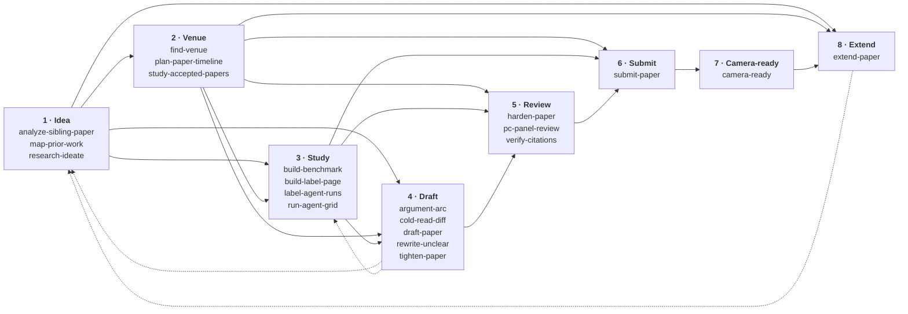
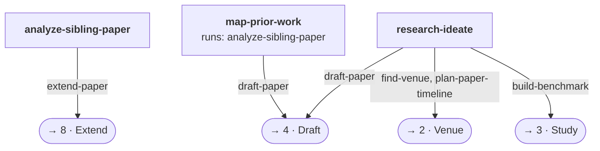
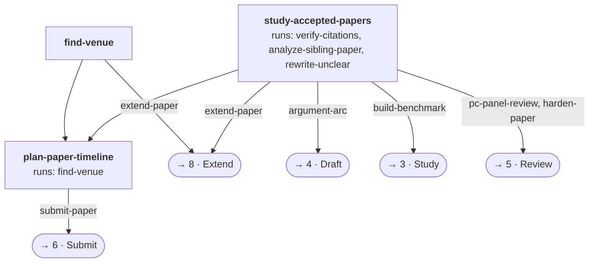
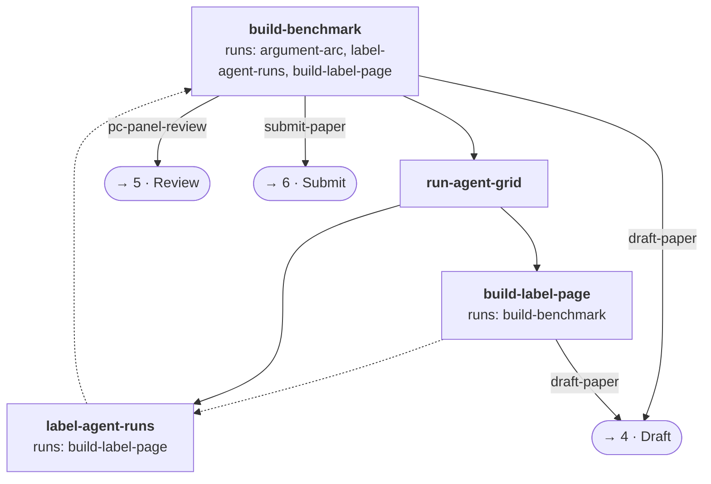
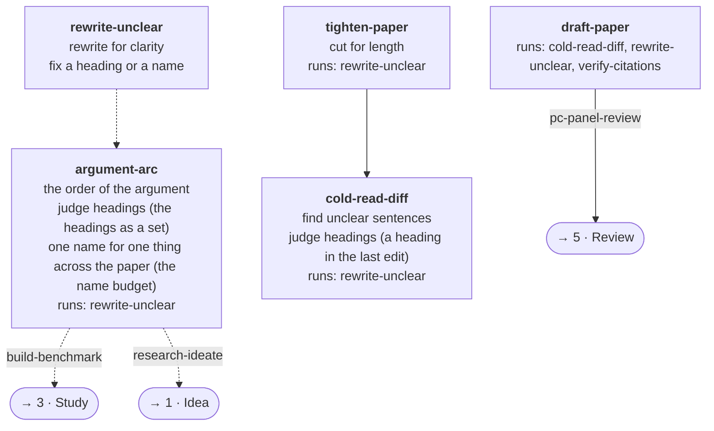
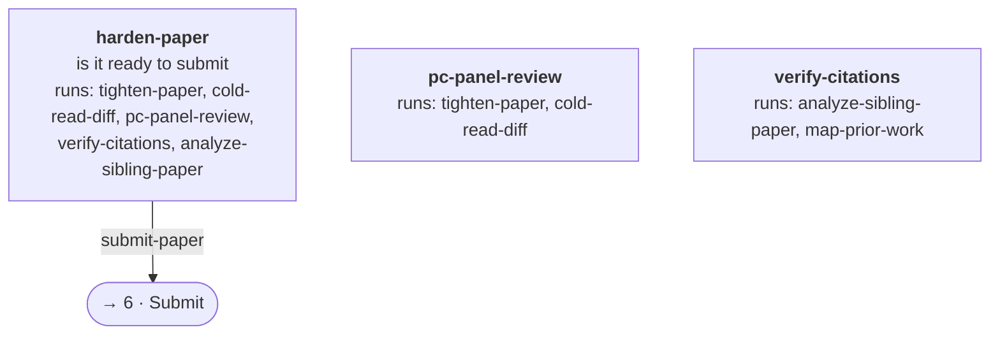
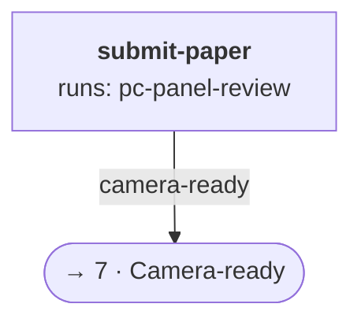
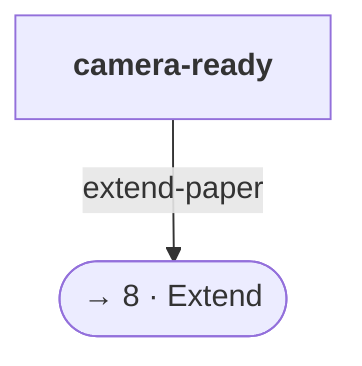
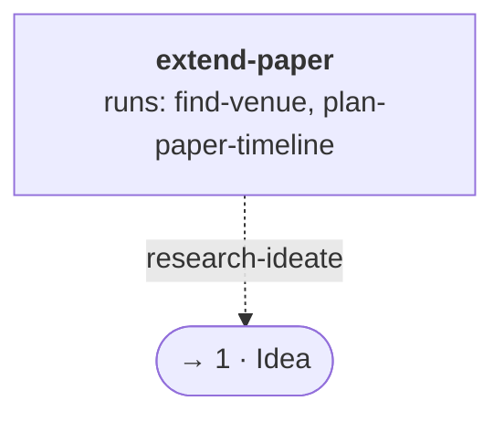

# The skill pipeline

<!-- Generated by `npm run pipeline` from each skill's `flow` export and `skills/jobs.ts`. Do not edit by hand. -->

Who hands work to whom, read from the skills themselves: each `skills/<name>/SKILL.md.spec.ts`
exports `flow`, and `skills/jobs.ts` names the one owner of each job on a paper's text. A flow
has three kinds of edge: **hands to** (27), the next step on the main path, drawn
solid; **loops back to** (6), work sent back to an earlier skill, drawn dashed;
**runs** (49), a skill this one runs as one of its own steps or whose output it needs,
written inside the box, never drawn. `test/pipeline.test.ts` fails on a cycle of hand-offs, a
hand-off to an earlier stage, an edge the skill's own text never names, a job without an owner,
and this file when it is stale. The stages are those of [`skills.md`](skills.md).

## The stages

Each arrow stands for one or more edges between skills of the two stages.

## Across every stage

- `paper-pipeline` (owns: which stage runs next; the final review) runs 21 skills: `research-ideate`, `map-prior-work`, `find-venue`, `study-accepted-papers`, `plan-paper-timeline`, `argument-arc`, `build-benchmark`, `run-agent-grid`, `label-agent-runs`, `build-label-page`, `draft-paper`, `verify-citations`, `analyze-sibling-paper`, `tighten-paper`, `cold-read-diff`, `rewrite-unclear`, `pc-panel-review`, `harden-paper`, `submit-paper`, `camera-ready`, `extend-paper`.
- `paper-status`.

## 1 · Idea

## 2 · Venue

## 3 · Study

## 4 · Draft

## 5 · Review

## 6 · Submit

## 7 · Camera-ready

## 8 · Extend

